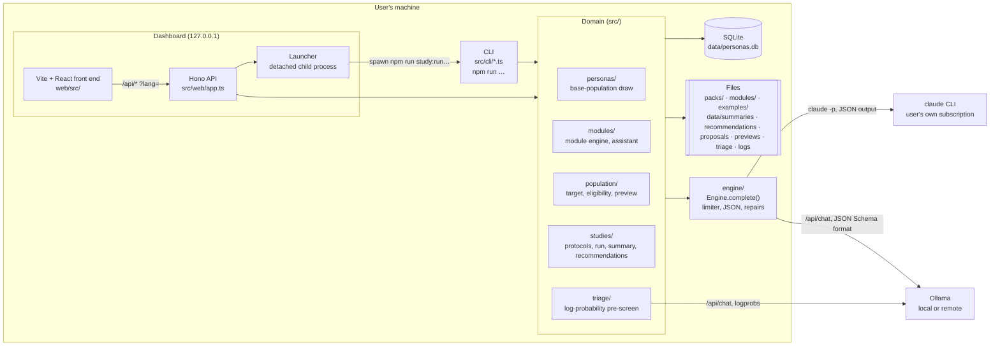
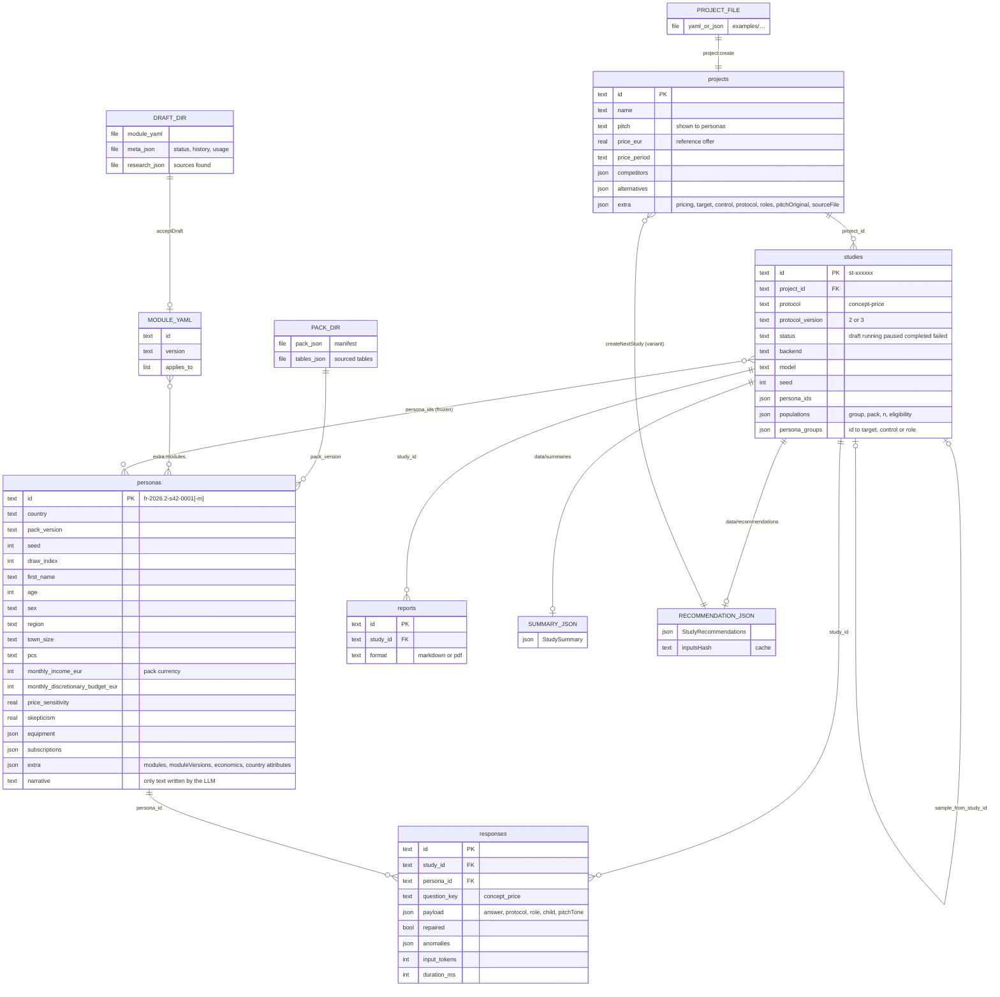
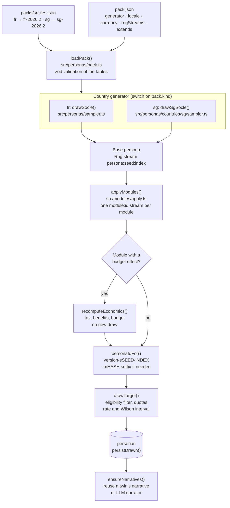
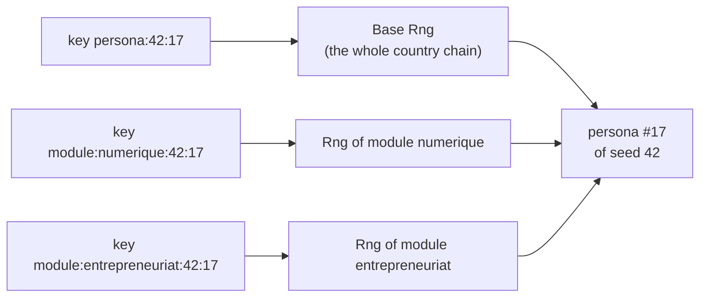
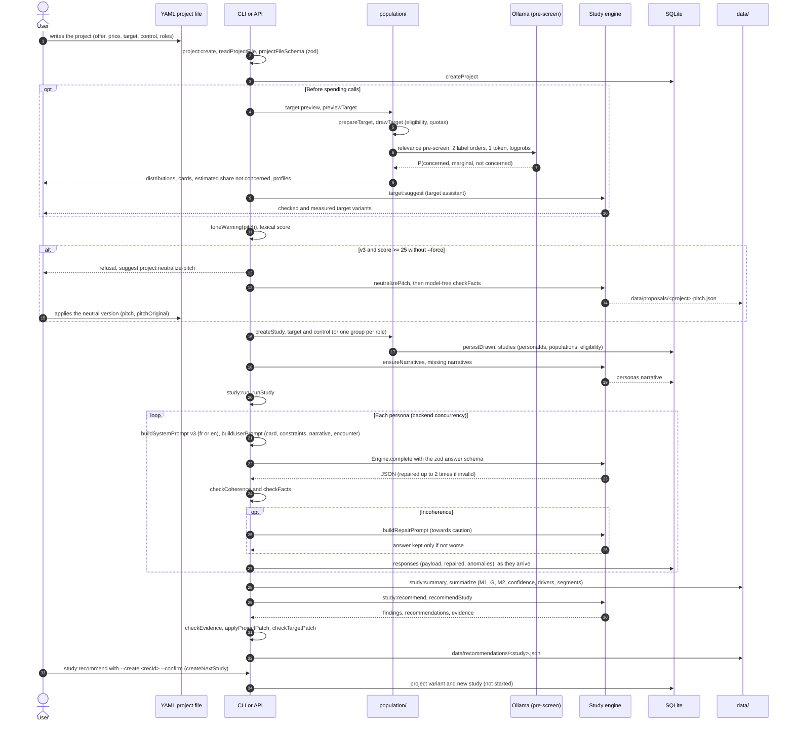
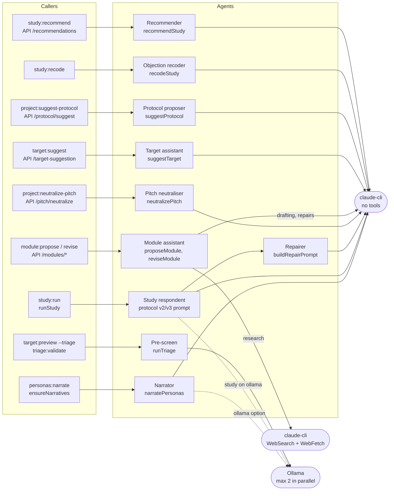
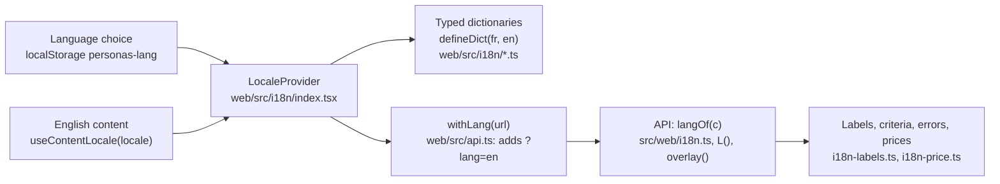
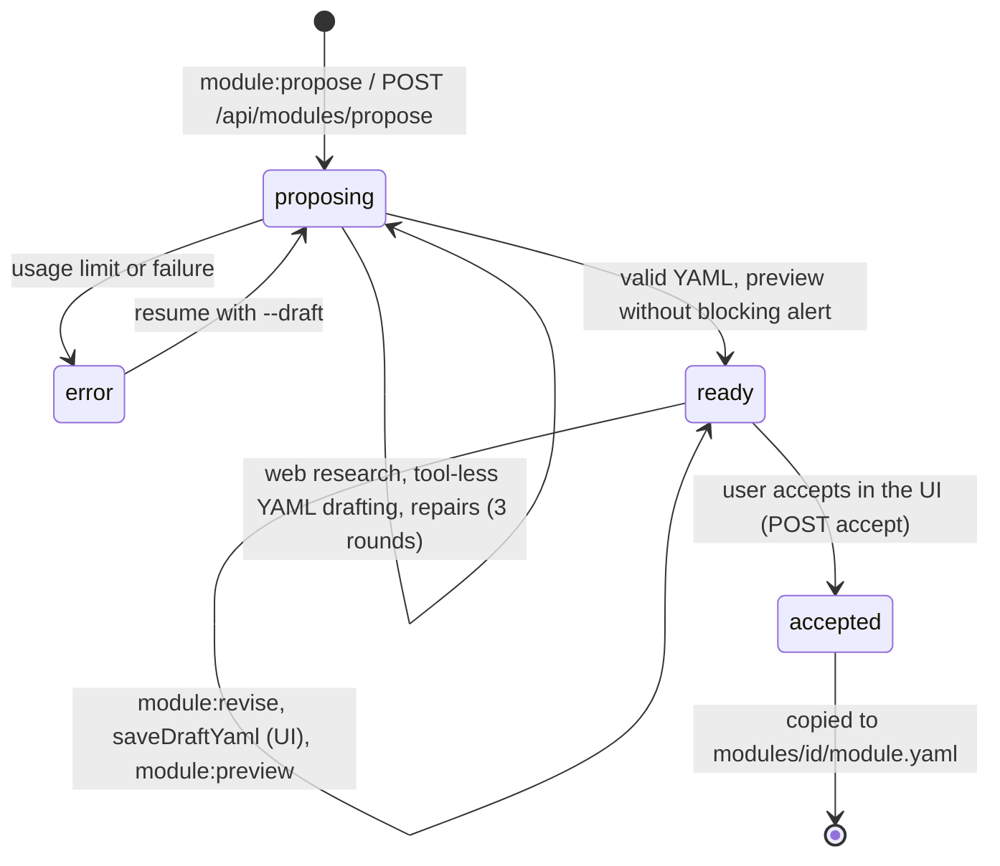

# Architecture

This document describes the code as it exists. The product principles are in the [README](../README.md), the study protocol in [study-protocol.md](study-protocol.md), the module format in [modules.en.md](modules.en.md) and the country-pack contract in [country-packs.md](country-packs.md).

## Contents

1. [Overview](#1-overview)
2. [Data model](#2-data-model)
3. [Persona generation](#3-persona-generation)
4. [Study pipeline](#4-study-pipeline)
5. [LLM agents](#5-llm-agents)
6. [Roles, languages, country packs](#6-roles-languages-country-packs)
7. [Creating inputs](#7-creating-inputs)
8. [Tests, identity proofs, operating rules](#8-tests-identity-proofs-operating-rules)

> Identifiers, table names and code are in English. Some code comments, console messages and the French-population prompts are in French; the French prompts are frozen by snapshot tests and are not translated.

---

## 1. Overview

A single Node package (strict TypeScript, ESM, Node 22 or later), with no external service other than the LLM engines:

| Layer | Where | Role |
|---|---|---|
| CLI | `src/cli/*.ts`, run with `npm run <script>` (tsx) | Every operation: draw, target, create and run a study, summarise, recommend, assistants |
| API | `src/web/app.ts` (Hono), `src/web/*-routes.ts` | Reads the database and files, creates projects and studies, launches long tasks |
| Dashboard | `web/src/` (Vite, React 19, wouter) | Projects, studies, personas, modules, comparison pages; bilingual |
| Domain | `src/personas`, `src/modules`, `src/population`, `src/studies`, `src/triage` | Statistical drawing, modules, targeting, protocols, analysis |
| Engines | `src/engine/` | Single interface `Engine.complete()` and the `claude-cli`, `ollama` and `anthropic-api` (disabled) backends |
| Storage | `data/personas.db` (SQLite, WAL), `data/*/` (JSON), `packs/`, `modules/`, `examples/` | Relational database plus versioned files |



Key points:
- **The CLI is the source of truth for long jobs.** The API runs `study:run` (and the other long tasks) in a detached child process (`src/web/launcher.ts`) that logs to `data/logs/`. Progress is read from the database (number of answers), not from the process. The launcher removes every `ANTHROPIC_*` variable from the child's environment.
- **Two dashboard modes**: `npm run dev:web` (`src/web/dev.ts`: API on an internal port, Vite on the public port, proxying `/api`) and `npm run start:web` (`src/web/server.ts`: API and `web/dist` on a single port). Public port `PERSONAS_WEB_PORT` (default 5173), internal port `PERSONAS_API_PORT` (default 5174). Both listen on the loopback interface only.
- **Configuration**: `src/config.ts` (zod) reads `.env`, then the environment: database path, `claude` binary and model, Ollama URL and model, concurrency limits, timeouts. See `.env.example`.

---

## 2. Data model

The database (`src/db/schema.ts`, Drizzle, migrations in `drizzle/`) has only five tables. Everything else lives in versioned or generated files, on purpose: modules and packs are reviewed in Git, and assistant outputs are reviewed by the user before they are applied.



| Data | Storage | Written by | Notes |
|---|---|---|---|
| Personas | `personas` table | `persistDrawn` (`src/population/target.ts`), `insertPersonas` | A cache: the database only holds personas that a study kept. Unique index `(pack_version, seed, draw_index)`. A persona is never rewritten. |
| Base populations (packs) | `packs/<version>/pack.json` + JSON tables | by hand or by a build script (e.g. `packs/sg/build-tables.py`) | `packs/socles.json` maps `fr` and `sg` to the current pack |
| Modules | `modules/<id>/module.yaml` | `acceptDraft` | `modules/_archive/`: `legacy` modules, still readable but no longer offered |
| Module drafts | `modules/_drafts/<draftId>/` | module assistant | `module.yaml`, `meta.json`, `research.json` |
| Projects | `projects` table (source file in `extra.sourceFile`) | `createProject` (`src/studies/project.ts`) | YAML or JSON file validated by `projectFileSchema` |
| Studies | `studies` table | `createStudy` (`src/studies/study.ts`) | Sample frozen at creation |
| Answers | `responses` table | `runStudy` (`src/studies/run.ts`) | Unique index `(study, persona, question)`: an interrupted study resumes without redoing what exists |
| Summaries | `data/summaries/<study>.json`, `compare-….json`, `-drivers.json` | `study:summary`, `study:compare`, `study:drivers` | The API recomputes summaries on demand with `summarize()` |
| Recommendations | `data/recommendations/<study>.json` and `.input.json` | `recommendStudy` | Cached by `inputsHash` |
| Proposals | `data/proposals/*.json` | pitch neutraliser, protocol proposer | Never applied automatically |
| Previews and pre-screen | `data/previews/`, `data/triage/relevance.jsonl` | `previewTarget`, `runTriage` | Append-only JSONL cache |
| Calibration | `calibration/payment-v3.json` | `calibration:fit` | M2 conversion parameters; shipped uncalibrated |

Conventions: despite their name (historical), `*_eur` columns hold amounts **in the pack's currency**. `extra` carries everything specific to a country, a module or a version, without a schema migration.

---

## 3. Persona generation

### 3.1 Principle

**Attributes are drawn statistically; the LLM only writes the narrative.** Drawing is free and deterministic, and it produces "virtual" personas at will. Only those that enter a study are stored and get a narrative.



### 3.2 Country packs

A country is a `packs/<country>/` directory and a generator in the code. Full contract: [country-packs.md](country-packs.md).

- **Manifest** (`manifestSchema`, `src/personas/pack-common.ts`): `country`, `version`, `population`, `ageMin`, `ageMax`, `extends`, `modules`, `targeted`, `rngStreams`, and the three contract fields `generator` (`fr` | `sg`), `locale` (`fr` | `en`), `currency` (`EUR` | `SGD`).
- **Common tables** (same schema for every country): `ageSex`, `regions`, `livingStandard`, `digital`, `subscriptions`, `psychographics`, `firstNames`.
- **Generator-specific tables**: France `packSchema` (`src/personas/pack.ts`); Singapore `sgPackSchema` (`src/personas/countries/sg/pack.ts`).
- **Per-country entry points** (type `Pack = FrPack | SgPack`):

| Generic function | France | Singapore |
|---|---|---|
| base draw | `sampler.ts` (`drawSocle`) | `countries/sg/sampler.ts` |
| budget recomputation | `economics.ts` | `countries/sg/economics.ts` |
| persona card (`describeForPrompt`, `formatPersona`) | `describe.ts` | `countries/sg/describe.ts` (English) |
| variables for modules and the eligibility filter | `modules/apply.ts` (`socleVars`), `population/target.ts` (`eligibilityVars`) | `countries/sg/vars.ts` |
| variable catalogue | `SOCLE_VARS`, `SOCLE_CODES` | `SOCLE_VARS_SG`, `SOCLE_CODES_SG` (`modules/registry.ts`) |
| margin validation | `validate.ts` | `countries/sg/validate.ts` |

The Singapore chain: residency status × age × sex → nationality, ethnicity → religion, home language → education → name → activity (national service) → SSOC occupation → gross income, CPF, net income → household → planning area × dwelling → tenure → tax and transfers → expenses → technology profile, equipment, subscriptions → budget → psychographics (same model as France).

### 3.3 Deterministic drawing and random streams

`src/personas/rng.ts`: an `sfc32` generator seeded by a `cyrb128` hash of a text key, never `Math.random`. Each persona has its own stream, so drawing index *i* depends neither on the total count nor on the order.



- `Rng.forPersona(seed, index, stream)` creates the stream; `moduleStream(seed, index, moduleId)` the stream of a module.
- **v2 base populations** (`rngStreams: "module"`: fr-2026.2, sg-2026.x): the base is drawn alone, then each module in its own stream. Adding or removing a module changes neither the base nor the other modules (`drawPersonaV2`).
- **v1 packs** (fr-2026.1, fr-tech-founders): modules consume the base stream at two fixed points, `work` and `profile`.
- `quasi` sampling is available for an enum attribute (Kronecker sequence indexed by the draw index, `quasiUniform`): margins stick to their targets even on a few hundred personas.

### 3.4 Thematic modules

A module is a declarative YAML file (`modules/<id>/module.yaml`), validated by zod (`src/modules/schema.ts`) then by semantic checks (`checkModule`, `src/modules/registry.ts`); the generic engine is `src/modules/engine.ts`. There is no per-module code. Guide: [modules.en.md](modules.en.md).

- **Attributes**: `enum` (weights, or `given` + `table` conditioned on one or more attributes, including `socle.*`), `set` (independent rates, `rate_cap`, `max_items`), `number` (expression), `boolean`. Declaration order is draw order; `when` makes an attribute absent without consuming a draw.
- **Computation primitives** (`evalExpr`): `lookup`, `pick`, `mul`, `add`, `div`, `min`, `max`, `exp`, `round`, `round_to`, `normal`, `lognormal`, `bernoulli`, `if`, `cases`.
- **Effects on the base persona**: `socle_overrides.monthly_income` (replaces income, e.g. a freelancer's day rate) and `affects_budget` on a set of subscriptions. `moduleEconomics()` detects the effect; `recomputeEconomics()` recomputes tax, benefits, disposable income, living standard, discretionary budget and price sensitivity, without a new draw, and records before/after in `extra.economics`.
- **Outputs**: codes in `extra.modules.<id>.<key>`, versions in `extra.moduleVersions`, card lines (`cardLines`), analysis segments (`librarySegments`), ready-made filters (`eligibility_helpers`).
- **Current library**: `numerique`, `entrepreneuriat`, `equipement-ecosysteme`, `productivite-reunions` (French base); `barbecue-reception`, `viande-alimentation`, `achats-groupes-communaute` (Singapore base). Archived: `entrepreneuriat-tech`.

### 3.5 Narratives

`src/personas/narrate.ts`: `narratePersonas()` sends personas in batches of 10 with the base card (without module lines, so the narrative stays generic). French or English instructions according to `pack.manifest.locale` (`narrativeSystemFor`). The batch JSON is validated by zod, matched to the personas (`matchBatch`), then checked (`checkNarrative`: first name and age first, at most one amount, no advertising, length, clichés flagged by `frequencyReport`, and in English no stereotype tied to ethnicity, religion, nationality or pass). `ensureNarratives()` (`src/population/narratives.ts`) first reuses the narrative of a "twin" with an identical base (same seed, same index, another pack version), without any call.

### 3.6 Versioning

| Base | Directory | State |
|---|---|---|
| `fr-2026.1` | `packs/fr` | v1 base, shared stream |
| `fr-tech-founders-2026.1` | `packs/fr-tech-founders` | v1 targeted pack (archived module `entrepreneuriat-tech`) |
| `fr-2026.2` | `packs/fr-2026.2` (`extends: fr`) | Current French base: same tables, one stream per module |
| `sg-2026.1` | `packs/sg` | First Singapore base, still loadable and reproducible |
| `sg-2026.2` | `packs/sg-2026.2` (`extends: sg`) | Names drawn by group × religion × sex × generation; same chain and margins as sg-2026.1 otherwise. Current Singapore base. |

Identifiers (`personaIdFor`, `src/personas/sampler.ts`):
- `<version>-s<seed>-<4-digit index>` when every module is at the base's version (`baseModuleVersion`: "2026.2" for fr-2026.2) and has no budget effect;
- otherwise a `-m<first 6 characters of the SHA-1>` suffix of the "id@version" of the modules concerned, e.g. `fr-2026.2-s42-0001-m15bfff`.

A new module version therefore never rewrites an existing persona: past studies keep their personas, new ones draw other identifiers. `persistDrawn` refuses a different base under the same identifier.

---

## 4. Study pipeline



Steps and code:

1. **Project** (`src/studies/project.ts`): `readProjectFile` reads YAML or JSON, `projectFileSchema` validates it, `createProject` (`--update` for an existing project) stores the generic price, target, protocol and roles in `extra`.
2. **Target, control, eligibility** (`src/population/`): `prepareTarget` resolves base and modules (`resolveModules`, `applies_to`, `requires`) and compiles the filter (`compileEligibility`: `and`/`or`/`not`, comparisons, `in [..]`). `drawTarget` draws index after index with the study's seed, keeps eligible personas up to *n*, measures the rate and its Wilson interval, warns below 0.5 % and stops after `max_draws` (1 million).
3. **Preview and pre-screen** (`previewTarget`, `src/triage/`): no study engine involved. The Ollama pre-screen estimates the share of "not concerned" personas as the mean of P(not concerned), with a bootstrap interval, and warns above 10 %. It is a pre-launch guard, not a measurement, and it is not wired into `runStudy`.
4. **Pitch tone** (`src/studies/pitch-tone.ts`): `lexicalTone` and `toneWarning` (threshold 25, French or English markers). In v3, `createStudy` refuses a promotional pitch unless `force`; the pitch is never neutralised silently.
5. **Prompts** (`src/studies/protocols/concept-price.ts`, `concept-price-en.ts`): `buildSystemPrompt` (anti-sycophancy rules, offer, price, `studyTiers` price tiers with the low tier added in v3, the project's own protocol via `resolveProtocol`), `buildUserPrompt` (card `personaCard` restricted to the population's modules, `constraintsBlock` with budget and subscriptions, narrative, discovery situation `pickEncounter`). `protocolVersionOf` reads any study that is not v3 as v2.
6. **Answers** (`runStudy`): `Engine.complete` enforces the schema (`answerSchemaFor` or `roleAnswerSchema`). Checks: `checkCoherence` (e.g. `vw_not_ordered`, `gg_not_monotonic`, `pay_without_gg`, `budget_unjustified`, `minimum_over_budget`, `need_frequency_mismatch`, `not_concerned_but_engaged`…) and `checkFacts` (`src/studies/protocols/facts.ts`: `invented_partner`, `invented_child`, `invented_business`, `invented_job_status`…). At most one repair; the repaired answer is kept only if it has no more anomalies, and the original is kept in `payload.originalAnswer`. Hitting a usage limit puts the study in `paused`; `study:run` resumes what is missing.
7. **Summary** (`src/studies/summary.ts`, `summarize`): behaviours, relevance, objections, Van Westendorp and Gabor-Granger (`pricing.ts`), base and module segments, automatic dimensions, drivers (`drivers.ts`: bias-corrected Cramér's V, permutations, Benjamini-Hochberg), the dual payment measure (`payment.ts`: observed M1, G at the low tier, M2 conversion), the confidence index (`confidence.ts`). Variant comparison: `compare.ts`.
8. **Recommendations** (`src/studies/recommend.ts`): `buildRecommendationContext` assembles a compact JSON, `recommendStudy` calls the model, checks each piece of evidence (`checkEvidence`: the path must exist and the value must match), merges and validates each `projectPatch`, measures the eligibility of a new target (`checkTargetPatch` via `checkVariant`), allows one repair, then drops whatever is still wrong (recorded in `verification`).
9. **Next study**: `createNextStudy` creates a variant that differs only by the patch (file `examples/variants/<project>-<recId>.yaml` or a project in the database, `extra.variantOf`), on the same sample or a new target, without starting it.

---

## 5. LLM agents

Every agent goes through `Engine.complete()` (`src/engine/engine.ts`): a concurrency limiter shared per backend within the process (`getEngine`), conversion of the zod schema into a JSON Schema enforced natively (`--json-schema` for `claude`, `format` for Ollama), JSON extraction and validation, **up to 2 schema repairs** (`buildRepairPrompt` in `src/engine/json.ts`), cumulative usage. The `claude-cli` backend runs `claude -p` with no tools, no user settings and no MCP, in an environment stripped of `ANTHROPIC_*` variables (`buildClaudeEnv`, `buildClaudeArgs`).



| Agent | Code | Engine | Input → output | Guarantees |
|---|---|---|---|---|
| **Narrator** | `src/personas/narrate.ts` | `claude-cli` (option `ollama`) | base card in batches of 10 → short narrative | Batch zod schema, `matchBatch`, `checkNarrative`. Writes **no** attribute. |
| **Study respondent** | `src/studies/run.ts`, `protocols/concept-price*.ts` | the study's backend (`claude-cli` or `ollama`) | v2/v3 system prompt + card + constraints + narrative → answer JSON | zod schema per tier set and protocol, anti-sycophancy rules (inertia by default, concrete and current need, real budget and subscriptions, often-free alternatives, "approving is not acting", decisive objections only), 7-day horizon. |
| **Repairer** | `buildRepairPrompt` (`concept-price.ts`, `-en.ts`) | same engine | answer + anomaly codes and details → corrected answer | One attempt, towards caution; kept only if not worse; remaining anomalies are recorded. |
| **Pre-screen** | `src/triage/` (`runTriage`, `relevanceSystem`, `ollamaLogprobClient`) | Ollama `/api/chat`, `num_predict: 1`, `top_logprobs` | protocol prompt without output instructions + card → probabilities over 3 digits | Two label orders averaged, JSONL cache, concurrency capped at 2. A pre-launch guard, not a measurement. |
| **Pitch neutraliser** | `src/studies/pitch-neutralize.ts` | `claude-cli` | pitch → factual version, flagged passages, missing information | Model-free `checkFacts` (numbers, units, proper names, key terms; an added number is refused), one repair, lexical score before/after. Proposes, applies nothing. |
| **Module assistant** | `src/modules/assistant/` (`proposeModule`, `reviseModule`, `previewModule`) | `claude-cli`, research mode (`webTools: WebSearch, WebFetch`) then no tools | domain description → sourced YAML draft | zod and semantic validation, blocking preview alerts sent back to the model (3 rounds), refit on `validation.shares`; a `ready` draft is accepted **by the user only** (`acceptDraft`). |
| **Target assistant** | `src/population/suggest.ts` (`suggestTarget`, `checkVariant`) | `claude-cli` | pitch, offer, catalogue of validated modules → target variants | Filter and codes checked, quotas checked, at least one eligible persona in 30,000 draws, 3 repairs, preview of each variant. Nothing is written to the project. French variable catalogue only for now. |
| **Protocol proposer** | `src/studies/protocol-suggest.ts` (`suggestProtocol`, `gatherObjections`) | `claude-cli` | project + real objections from past studies → `protocol` block | `projectProtocolSchema` (increasing scale starting at `inaction`, one `payment` level, a `no_need` category, a `not_concerned` level). Written to `data/proposals/`; the user copies the block. |
| **Objection recoder** | `src/studies/recode.ts` (`recodeStudy`) | `claude-cli` | a study's objections + taxonomy → new codes | Stored in `payload.recoded[key]`; the original is never modified. |
| **Recommender** | `src/studies/recommend.ts` | `claude-cli` | compact summary, verbatims, project, related studies, caveats → findings and recommendations | Each piece of evidence checked against the input, patches validated by zod, targets measured, fixed caveats first (calibration status, systematic pessimism, differences more reliable than levels, small samples), cached by `inputsHash`. The next study is only created on confirmation. |

**Anti-sycophancy belongs to the protocol, not to the project.** The study prompt rules, the coherence and invented-fact checks, the v3 refusal of promotional pitches and the rule that M1 is always shown with M2 and the confidence index apply to every study. Any change to a study prompt must preserve them. The prompt snapshots in `test/studies/__fixtures__/` detect any drift.

---

## 6. Roles, languages, country packs

### 6.1 Multi-role studies (`src/studies/roles.ts`, `role-view.ts`)

A project can replace `target` and `control` with `roles`: one study group per role, each with its own target, its own view of the offer (`pitch`, `price`, `offerNote`) and a perspective `user`, `payer`, `payer_for_child` or `both`. `rolePopulations` produces the populations for `createStudy`; `runStudy` prepares, once per role, the view (`roleProject`), the prompt (`buildRoleSystemPrompt`, adaptations on checked anchors), the schema (`roleAnswerSchema`) and the checks. A `user` role has no Van Westendorp, no Gabor-Granger and no budget, but answers `expectedUsage`; a dependent payer (`dependsOn`) answers `adoptionThreshold`. For `payer_for_child`, the child comes from the household (`extra.childrenAges`), its modules (`applies_to: [fr-enfants]`) are drawn in their own stream, and `pickChild` picks it deterministically. The summary has one analysis per role and a `crossRoles` section. The engine is implemented and tested with a simulated backend; study creation through the API does not support roles yet.

### 6.2 Study language (`src/studies/locale.ts`)

`studyAudience(study)` reads the manifest of the first population's base: `locale`, `country`, `currency`. A study on an `en` base (Singapore) is entirely in English: narratives, system and user prompts (`concept-price-en.ts`), repairs, fact checks, tone markers, pre-screen, summary texts, and the instructions of the neutraliser, the protocol proposer and the recommender. An offer in another currency than the personas' gets an equivalence line (`price-model-en.ts`, `convertAmount`). A French audience gets exactly the historical French prompts. Still in French: CLI console output and the target assistant.

### 6.3 Bilingual dashboard



- **Front end**: each area declares `defineDict(fr, en)`; a missing or extra key on the English side is a typecheck error. `useDict` in components, `tr` outside. Without an explicit choice, a page whose content is English (a project on an `en` base) can request English. Switching language remounts the page (`LocaleKeyed`) and reloads the data.
- **API**: `?lang=en` (`langOf`) translates texts generated by the API; French remains the default. Stored summaries are never rewritten, only their presentation changes. `projectLocale` infers a project's language from `extra.locale` or from its target's base.

### 6.4 Country packs

Two generators (`fr`, `sg`), four loadable bases plus the historical targeted pack (§ 3.6). A module declares its bases (`applies_to`); a `fr` module is refused on an `sg` base. `socle.*` variables depend on the country (Singapore adds `residency_status`, `ethnicity`, `religion`, `home_language`, `education`, `dwelling`, `planning_area`). A third country follows the same contract ([country-packs.md](country-packs.md)).

---

## 7. Creating inputs

### 7.1 A project

A YAML or JSON file, validated by `projectFileSchema`. Annotated example (`examples/sg/recipe-app.yaml`):

```yaml
id: sg-recipe-app             # optional; otherwise derived from the name (lowercase, digits, hyphens)
name: Weeknight               # shown to personas
pitch: >-                     # what a user would see; factual (tone score < 25 in v3)
  Weeknight is a phone app that plans the week's dinners for the whole household. …
targetAudience: Working adults aged 25 to 50, often with children, who cook at home on weeknights.   # never shown
businessModel: Freemium; S$6.90 a month for personalised menus, the shopping list and the grocery link.  # never shown
price:                        # generic form (src/studies/price-model.ts)
  currency: SGD               # EUR, USD, SGD…
  offers:
    - id: monthly
      label: Weeknight Plus
      amount: 6.9
      unit: month             # month | year | one_time | usage | quantity
  tiers: [3.9, 6.9, 9.9]      # Gabor-Granger tiers; in v3 a low tier (≈ 0.4 × price) is added if missing
  freemium:
    free: basic weekly menus and recipes
    paid: personalised menus, shopping list, grocery link (Weeknight Plus)
competitors: [recipe websites and YouTube channels, meal-kit deliveries, online grocery apps]
alternatives: [cooking the usual family dishes, buying dinner at a hawker centre]
target:
  socle: sg                   # resolved through packs/socles.json
  modules: []                 # validated library modules with a compatible applies_to
  eligibility: "age >= 25 and age <= 50 and residency_status != mdw and dwelling != dormitory"
  n: 60
# control: { socle: sg, n: 20 }   # optional control group (not in the example file)
```

Without a `target` block, the study draws from the pack given by `--pack` and needs `--n`. Optional blocks: `quotas`, `protocol` (behaviour scale, objection taxonomy, relevance), `roles`, `pitchOriginal` and `pitchNeutralized`. Then:

```sh
npm run project:create -- --file examples/sg/recipe-app.yaml      # --update to re-import
npm run target:preview -- --project sg-recipe-app --triage       # before spending calls (--triage needs Ollama)
npm run study:create -- --project sg-recipe-app --seed 7         # v3 by default, missing narratives written
npm run study:run -- --study <study-id>
npm run study:summary -- --study <study-id>
npm run study:recommend -- --study <study-id>
```

Each command prints its usage when a required argument is missing or with `--help`.

### 7.2 A module

The assistant proposes, the user validates.



Details and commands: [modules.en.md](modules.en.md). A validated module only changes through a new `version` (with a `changelog`): personas already drawn keep their values (§ 3.6).

### 7.3 A country pack

See [country-packs.md](country-packs.md).

### 7.4 CLI commands (`package.json`)

| Area | Scripts |
|---|---|
| Database and engines | `db:generate`, `db:migrate`, `engine:check` |
| Personas | `personas:generate`, `personas:narrate`, `personas:validate`, `personas:show`, `personas:migrate-modules`, `population:draw` |
| Modules | `module:propose`, `module:revise`, `module:preview`, `module:accept` |
| Projects | `project:create`, `project:list`, `project:neutralize-pitch`, `project:suggest-protocol` |
| Target | `target:preview`, `target:suggest`, `triage:validate` |
| Studies | `study:create`, `study:run`, `study:summary`, `study:list`, `study:compare`, `study:drivers`, `study:recode`, `study:recommend` |
| Calibration | `calibration:fit` |
| Dashboard | `dev:web`, `build:web`, `start:web` |
| Quality | `typecheck` (server and `web/`), `test`, `test:watch` |

---

## 8. Tests, identity proofs, operating rules

### 8.1 Tests (`test/`, vitest)

Engines (`claude-cli`, `ollama`, limiter, JSON extraction), database schema, personas (drawing, narratives, Singapore base and names), modules (engine, plurals, budget recomputation), population (targeting), studies (prompts, protocol v3, coherence, facts, pitch tone, prices, roles, summary, comparison, recommendations, English), web (API, i18n, Singapore locale, modules, pitch). **Tests never call a real LLM**: they inject a simulated backend or client. Prompt snapshots live in `test/studies/__fixtures__/` (reference v2 prompt, prompts per price model, roles, English).

### 8.2 Identity proofs (`eval/identity/`)

Any structural change must prove that it modifies neither existing personas nor the prompts of past studies. The published scripts work on virtual draws and read no database:

| Script | What it proves |
|---|---|
| `draw-hash.ts` | Draw fingerprints: base alone, base + modules, historical pack |
| `economics-noop.ts` | The budget recomputation with unchanged inputs finds the drawn values again |
| `income-by-status.ts` | Median income and discretionary budget by status (module `numerique`) |

Run them with `npx tsx eval/identity/<script>.ts` before and after a change and compare the outputs. The common method: read-only, output to a folder, diff before and after.

### 8.3 Operating rules

- **Ollama: concurrency 2 at most.** `OLLAMA_MAX_CONCURRENCY = 2` in `src/config.ts`, enforced by `OllamaBackend` and by the pre-screen client whatever the settings say: the server may be shared with other services.
- **No paid API by default.** The `anthropic-api` backend is an empty placeholder that throws; `study:create`, `study:run`, `personas:narrate` and `createStudy` refuse it; `claude-cli` and the launcher strip `ANTHROPIC_*` from the environment. The default engine is `claude-cli`, with the user's own subscription.
- **Usage limits**: `claude-cli` is limited to 2 concurrent calls by default (`CLAUDE_CLI_CONCURRENCY`). A usage limit pauses the study (resume with `study:run`) and puts a module draft in `error` (resume with `--draft`).
- **Validation**: a module, a pitch neutralisation, a protocol or a next study is proposed by an assistant and applied only after the user's review.
- **No secret in the repository**: keys and addresses go in `.env`, which is ignored by Git.
