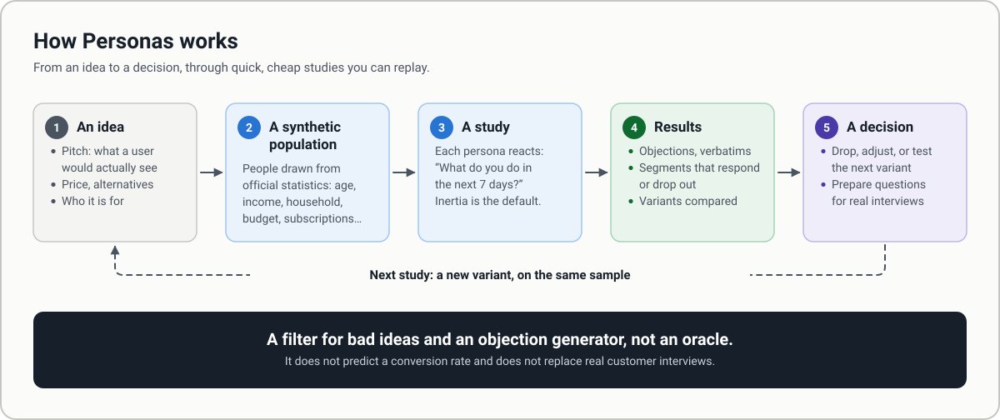
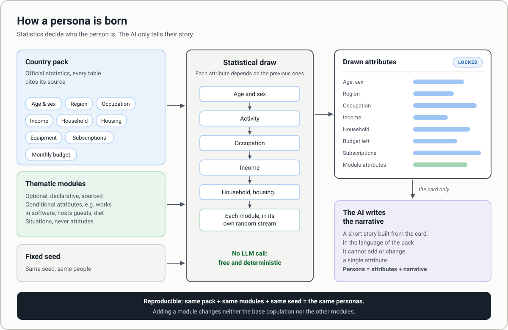
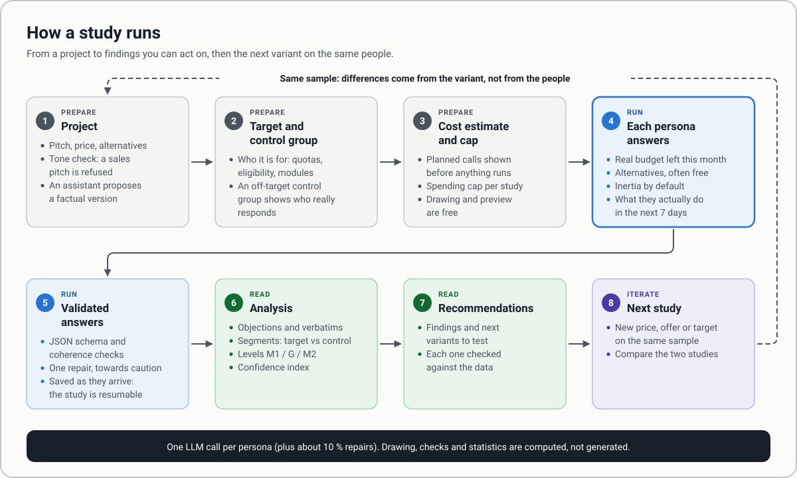
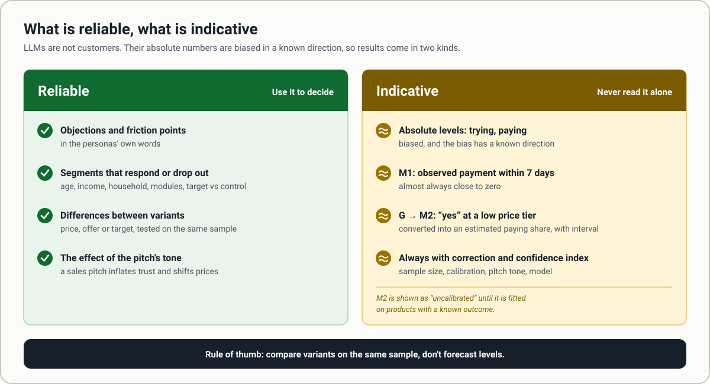
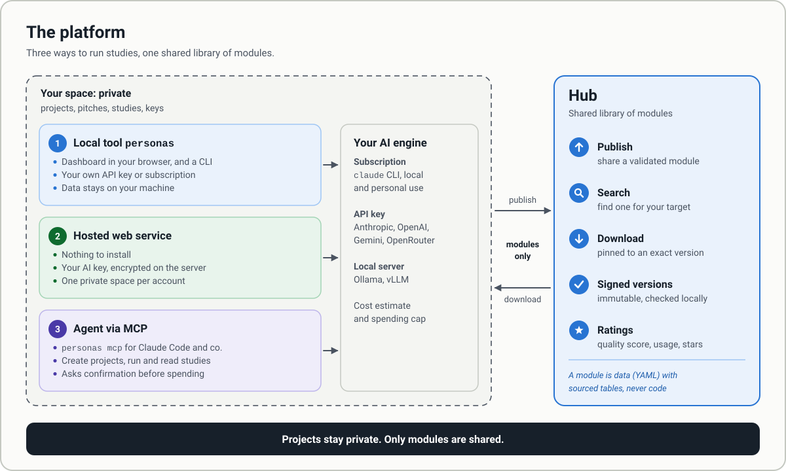

# How Personas works

Five diagrams that explain what Personas does and how to use it. For how the code is organised, see [architecture.md](architecture.md).

## 1. Overview

You describe an idea (pitch, price, target). Personas shows it to a synthetic population drawn from official statistics, and each persona says what it would actually do in the next 7 days. You get objections, segments that respond or drop out, and comparisons between variants. Then you drop the idea, adjust it, or test the next variant on the same sample.

## 2. How a persona is born

Every attribute (age, income, household, budget, subscriptions, module attributes) is drawn from sourced tables: a country pack, plus optional thematic modules. The AI only writes a short narrative from the drawn card and cannot change any attribute. With the same pack, modules and seed you get the same personas. See [country-packs.md](country-packs.md) and [modules.en.md](modules.en.md).

## 3. How a study runs

A study starts from a project with a neutral pitch (a promotional pitch is refused), a target and an off-target control group. You see the planned calls and a spending cap before anything runs. Each persona answers under real constraints: budget left this month, alternatives, inertia by default. Answers are validated as they arrive, then analysed and turned into recommendations. The next variant runs on the same sample, so differences come from the variant and not from the people. See [study-protocol.md](study-protocol.md).

## 4. What is reliable, what is indicative

Objections, segments and differences between variants are reliable enough to decide. Absolute levels of trying and paying are biased in a known direction: they are always shown with a correction and a confidence index, never on their own.

## 5. The platform

You can run Personas as a local tool (`personas`, with your own key or subscription), as a hosted web service (with your AI key, encrypted on the server), or from an agent through MCP. The Hub is a shared library of modules: publish, search, download, signed versions, ratings. Projects, pitches and results stay private; only modules are shared.

