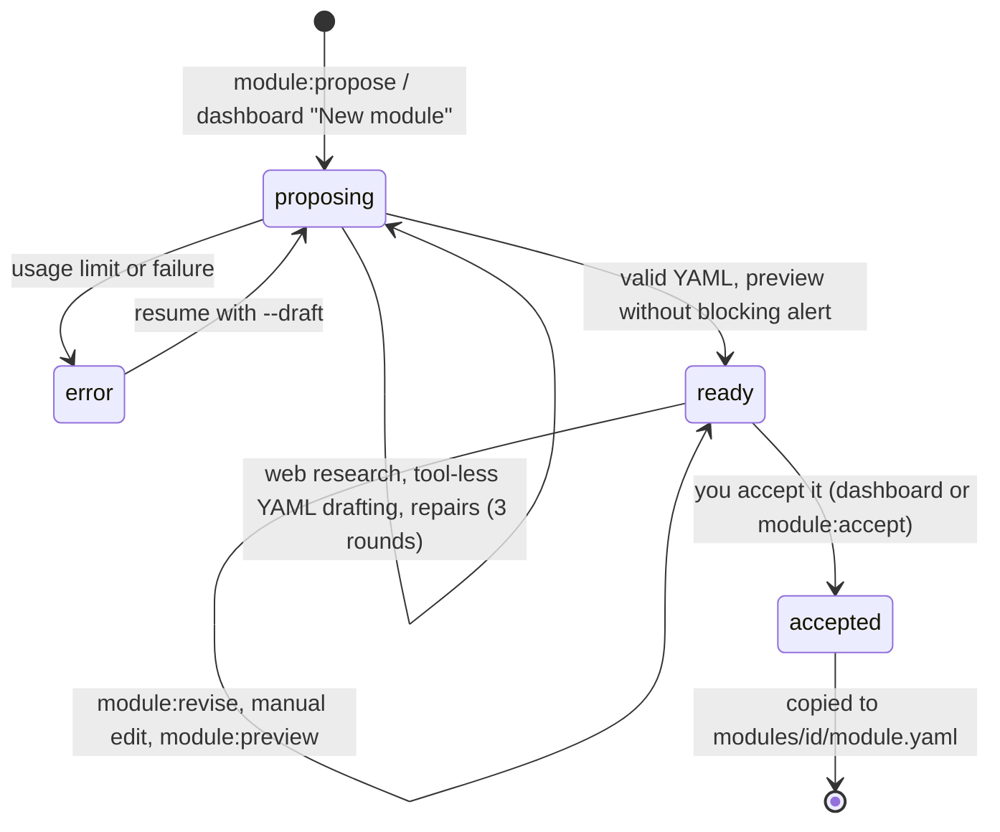

# Writing and validating a module

A **module** adds domain-specific attributes to the personas of a base population (a country pack): digital jobs, entrepreneurship, equipment, meetings, food habits, hosting at home… It is a **declarative YAML file**, `modules/<id>/module.yaml`. It contains no code: the generic engine (`src/modules/engine.ts`) draws it, renders its card lines, exposes its segments to the study engine and the dashboard, and validates it.

> `docs/modules.md` (in French) is the format reference that the module assistant reads in its prompt. This page is the English guide for contributors. When they disagree, the schema (`src/modules/schema.ts`) and the semantic checks (`src/modules/registry.ts`) are the source of truth.

## 1. When to write a module

Write a module when a study needs attributes the base population does not have, and that change who is concerned by an offer: "has a job in software", "hosts barbecues at home", "household diet". Do not write a module to make a target look enthusiastic: modules describe *situations*, drawn from statistics, never attitudes towards a product. Modules cannot change psychographics (scepticism, price sensitivity), and that is on purpose.

## 2. How a module is applied

On a v2 base (`rngStreams: "module"`, e.g. `fr-2026.2`, `sg-2026.2`), the base persona is drawn first, then each module in **its own random stream** `(seed, index, module)`. Adding or removing a module changes neither the base nor the other modules. A project activates modules through its target:

```yaml
target:
  socle: sg                       # resolved through packs/socles.json
  modules: [viande-alimentation]
  eligibility: "age >= 25 and viande-alimentation.dietary_restriction in [none, no_beef]"
  n: 60
```

Drawn values are stored as codes in `extra.modules.<id>.<key>`, and the module version in `extra.moduleVersions`. Labels always come from the module definition.

## 3. Structure

```yaml
id: my-module                     # = directory name
version: "2026.1"
changelog:                        # most recent first
  - {version: "2026.1", date: "2026-01-15", changes: ["First version."]}
label: My domain
short_label: Domain               # display prefix
description: >-
  What the module models and for whom.
applies_to: [sg]                  # compatible bases (root of the extends chain): fr, sg…
requires: []                      # other modules, drawn before (acyclic graph)
sources:                          # bibliography, cited by key
  survey2025: {org: "Statistics office", title: "…", year: 2025, url: "https://…", detail: "what was taken from it"}
conditions:                       # named, reusable conditions
  young_children: {attr: socle.children_under_12, gt: 0}
tables:                           # reference tables (lookup)
  spend_factor: {values: {alone: 0.5, couple_with_children: 1.3}, assumption: true, justification: "…"}
attributes: […]                   # declaration order = draw order
card: […]                         # card lines
segments: […]                     # analysis dimensions
eligibility_helpers: {…}          # ready-made filters
validation: {margins: […], shares: […], plausibility: […]}
```

Labels and card lines are written in the language of the base: English for `sg`, French for `fr`, since the persona cards and the study prompts of that base are in that language.

### 3.1 Provenance is mandatory

Every attribute and every table cites at least one source (`sources: [key]`), **or** carries `assumption: true` with a `justification`. Anything without either is refused at load time. A source has `org`, `title`, `year`, `url` and an optional `detail` saying what figure was taken and whether the page was actually read. Say "not verified" when it was not.

### 3.2 Attributes

Common fields: `key` (snake_case), `label`, `type`, `phase`, `when`, `display`, provenance.

| type | Content |
|---|---|
| `enum` | `values: [{code, label}]`, with a plain label or a gendered one `{M, F}`. `distribution`: `weights` (numbers, or expressions evaluated per persona), or `given` + `table` (conditioned on one attribute or several, e.g. `given: [socle.activity_status, socle.pcs]`, nested table in that order, a `default` key allowed at each level). `sampler: random` (seeded generator) or `quasi` (Kronecker sequence indexed by the draw index: margins stick to their targets even on a few hundred personas). |
| `set` | Multi-select: `items: [{code, label, card_label?, rate, subscription?}]`. Each option is drawn independently with its rate. `rate_cap` caps each rate, `max_items` drops the excess at random, `min_items` fills in proportionally to the rates. |
| `number` | `value`: an expression (§ 3.4). Optional `unit`. |
| `boolean` | `rate`: probability of being true, or `value`: an expression, true if non-zero. `labels: {yes, no}`. |

- **Order**: an attribute may only reference an attribute declared before it (or a base variable). The loader refuses any other reference. Declaration order is the order in which the random generator is consumed, which makes the draw reproducible.
- **`when`**: presence condition. If false, the attribute is `null` and consumes no draw (e.g. a day rate only exists for freelancers).
- **`phase`** (`work` or `profile`) only matters for historical v1 packs; on a v2 base the whole base persona is already drawn.

A set rate accepts a multiplicative shortcut: `{base: 0.3, factors: {young_adult: 1.3, no_smartphone: 0.3}}`: the base rate is multiplied by the factor of each true condition, in order.

Example (Singapore base):

```yaml
attributes:
  - key: dietary_restriction
    label: Household dietary restriction
    type: enum
    values:
      - {code: none, label: no dietary restriction}
      - {code: halal_strict, label: strictly halal}
      - {code: vegetarian, label: vegetarian}
    distribution:
      given: socle.religion
      sampler: quasi
      table:
        islam: {halal_strict: 96, vegetarian: 2, none: 2}
        default: {none: 95, vegetarian: 5}
    sources: [census_religion]
    assumption: true
    justification: "Religion shares from the census; dietary rules by religion are assumptions."
```

### 3.3 Conditions

`{attr: X, in: [...]}`, `{attr: X, eq: v}`, `{attr: X, lt: n}`, `{attr: X, gt: n}`, `{attr: X, present: true}`, `{all: [...]}`, `{any: [...]}`, `{not: …}`, or the name of a condition declared in `conditions`.

Attribute references:
- `status` for an attribute of the module;
- `other-module.attr` for a required module;
- `socle.age` for a base variable. Base variables depend on the country: `age`, `sex`, `region`, `town_size`, `pcs`, `activity_status`, `household_type`, `children_under_12`, `partner_status`, `living_standard_ratio`, `monthly_income`, `has_computer`, `has_smartphone`, `has_tablet`, `has_internet`, `tech_adoption`, `social_media`…; Singapore adds `residency_status`, `ethnicity`, `religion`, `home_language`, `education`, `dwelling`, `planning_area`. The full catalogue with codes is in `src/modules/registry.ts` (`SOCLE_VARS`, `SOCLE_CODES`, `SOCLE_VARS_SG`, `SOCLE_CODES_SG`, `SOCLE_VAR_DOCS_SG`).

### 3.4 Expressions

Named computation primitives, written as one-key objects and evaluated left to right. They are the bounded escape hatch for derivations such as a freelancer's income.

| Primitive | Effect |
|---|---|
| `3.5`, `{attr: x}` | constant, value of an attribute |
| `{lookup: table, by: attr}` | value from a reference table, by enum code or by band (`bands`) of a numeric variable clamped to the bounds |
| `{pick: attr, values: {code: n}, default: n}` | inline table |
| `{mul: […]}`, `{add: […]}`, `{div: [a, b]}`, `{min: […]}`, `{max: […]}`, `{exp: e}` | arithmetic |
| `{round: e}`, `{round_to: 10, value: e}` | rounding |
| `{normal: {}}`, `{lognormal: {median, sigma}}`, `{bernoulli: p}` | random draws |
| `{if: cond, then, else}`, `{cases: [{when, value}, …, {else}]}` | branches |

There is no per-module code file. If a future domain needs logic these primitives cannot express (a loop, an optimisation), discuss it in an issue first.

### 3.5 Effects on income and budget

A module can:
- **replace the persona's personal income**: `socle_overrides: {monthly_income: {attr: monthly_income, when: freelance}}` (only one active module may declare `socle_overrides`);
- **deduct subscriptions from the discretionary budget**: on a set attribute, `affects_budget: true` (or `{when: cond}`, e.g. "paid out of pocket"); each drawn option with `subscription: {name, category, monthly_eur}` is added to the persona's subscriptions (amounts in the pack's currency despite the field name).

Only when a module declares an effect for a persona does the engine run a **deterministic recomputation** of the budget (tax, benefits, disposable income, living standard, expenses, discretionary budget, price sensitivity with the same random share), without any new draw, and records before/after in `extra.economics`. A persona without module effects keeps exactly its base draw (checked by `test/modules/economics.test.ts` and `eval/identity/economics-noop.ts`).

### 3.6 Card, segments, helpers, validation

- **`card`**: template lines added to the persona card of narratives and studies. `{attr}` is replaced by the rendering of the attribute: gendered label, comma-separated list for a set (`card_label` of the options), amount with `display.format: eur` (pack currency), percentage with `display.format: percent`. `display.template` ("about {value} h a week") and `display.empty` apply. A line can be conditional: `{when: cond, template: "…"}`. Card lines are facts about the person; never write instructions to the model in them (see [SECURITY.md](../SECURITY.md)).
- **`segments`**: `{id, attribute, label, compare?}`. The `id` is a stable analysis dimension used by quotas, `study:summary`, `study:compare` and the dashboard.
- **`eligibility_helpers`**: ready-made filters, e.g. `halal_household: "viande-alimentation.dietary_restriction == halal_strict"`, checked at validation.
- **`validation.margins`**: enum attributes whose observed margin is compared with the theoretical distribution (chi-square test and maximum gap). Margins conditioned on the base are compared with the **mean of each persona's expected distribution**, which is what makes it possible to validate a module on the general population.
- **`validation.shares`**: share of a sub-population (`among`) that meets a condition (`share_of`), within a sourced range (`range: [low, high]`).
- **`validation.plausibility`**: median of a value by group, within `median_in` ranges or relative to a reference table (`median_vs_table: {table, range: [0.75, 1.3]}`).

## 4. Workflow: propose, preview, revise, accept

The assistant proposes, **you** validate. Drafts live in `modules/_drafts/<draftId>/` (`module.yaml`, `meta.json` with status and history, `research.json` with the sources found) and are never used by studies.



| Command | Effect |
|---|---|
| `npm run module:propose -- --description "<domain>" [--id <module-id>] [--project <id\|file>] [--socle fr\|sg] [--draft <id>] [--no-research]` | Creates or resumes a draft. Research uses the `claude` CLI with WebSearch and WebFetch only; drafting runs without tools. |
| `npm run module:revise -- --draft <id> --instruction "<text>" [--research]` | Targeted revision, optionally preceded by a targeted source search; the history keeps the diff. After validation, distributions are refitted towards the declared `validation.shares`. |
| `npm run module:preview -- --draft <id> \| --module <id> [--n 10000] [--sample 5] [--json]` | Virtual draw of the base + module, margins, sample cards, helper rates and alerts |
| `npm run module:accept -- --draft <id> [--replace]` | Copies a validated draft into the library |

You can also write the YAML by hand in `modules/<id>/module.yaml` and preview it with `--module <id>`.

### 4.1 Preview alerts

`previewModule` draws 10,000 virtual personas by default and raises alerts:
- attribute without a source, more than 50 % assumptions;
- value never drawn, very rare category (below 0.5 % of the personas concerned);
- conditioning without effect (same distribution for everyone);
- declared margin or `validation.shares` not reached;
- inconsistency with the base: a computer, smartphone or tablet attribute on personas without that device is an **error** (blocking); a professional attribute on personas without a job is a warning.

Acceptance is refused if validation fails or if the preview has an `error` alert.

### 4.2 Validate on the general population

```sh
npm run personas:validate -- --pack sg-2026.2 --modules viande-alimentation --virtual 20000
npm run population:draw -- --project examples/sg/home-barbecue-chef.yaml --n 200 --drafts   # include drafts, read-only
```

Studies only accept validated modules; `--drafts` is for previews.

## 5. Versions and persona identity

- A validated module changes **only through a new `version`**, with a `changelog` entry. Codes should stay compatible between versions: old personas are rendered with the current labels.
- A persona in the database is **never rewritten**. Its identifier is `<pack>-s<seed>-<index>` when all its modules are at the base's version and have no budget effect; otherwise it gets a stable `-m<hash>` suffix computed from the "id@version" of those modules. Past studies keep their personas; new studies draw the new values under other identifiers.
- A retired module moves to `modules/_archive/<id>/` (`status: legacy`): still loaded to read historical studies, but no longer offered for targets.

## 6. Checklist before opening a pull request

- [ ] `id` matches the directory; `version` and `changelog` are set.
- [ ] `applies_to` lists the right base(s); labels are in the base's language.
- [ ] Every attribute and table has `sources` or `assumption: true` + `justification`; sources say what was taken and whether it was read.
- [ ] No attitude towards products, no psychographic override, no instruction to the model in labels or card lines.
- [ ] Sensitive attributes (ethnicity, religion, health, sexual orientation, political opinions, union membership) are justified by the use case.
- [ ] `npm run module:preview -- --module <id>` shows no `error` alert; remaining warnings are explained in the PR.
- [ ] `validation` declares margins or shares where a source gives them.
- [ ] `npm run typecheck` and `npm test` pass.

Modules are licensed under CC BY 4.0 ([modules/LICENSE](../modules/LICENSE)).
